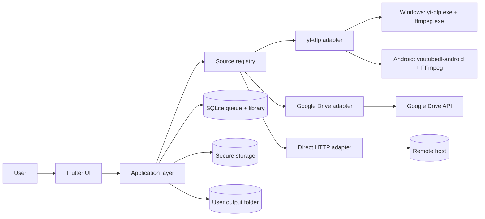

# Architecture — MediaFlow Rebuild

## 1. System context



One Flutter codebase. Native work is limited to the Android engine bridge,
foreground service, storage integration, and Google Sign-In. Windows runs the
engine as a subprocess from Dart.

## 2. Layers

```
lib/
  app/                 app shell, routing, theme, l10n
  features/
    analyze/           URL intake, probe, format selection
    queue/             active/waiting jobs
    library/           history and files
    settings/          preferences, auth, diagnostics
    sources/           source catalog / supported hosts
  domain/
    models/            MediaDescriptor, DownloadJob, DownloadEvent, errors
    sources/           SourceAdapter, SourceRegistry, capabilities
    queue/             scheduler, retry policy, state machine
    storage/           repositories (interfaces)
  infrastructure/
    engine/            YtDlpBridge, WindowsYtDlpEngine, AndroidYtDlpEngine
    drive/             Drive API client, OAuth
    http/              DirectHttpEngine
    db/                SQLite implementation
    auth/              cookie import, secure token store
    platform/          share, notifications, file open, storage
```

Rules:
- The domain layer has no Flutter or platform imports.
- Adapters depend on domain interfaces, not on UI.
- The UI never shells out and never touches cookie/token contents.
- All percentages crossing a boundary are `0..1`.

## 3. Source adapter contract

```dart
enum MediaKind { video, audio, image, file, collection }

class SourceCapabilities {
  final bool singleItem;
  final bool collection;
  final bool live;
  final bool audioOnly;
  final bool requiresAuth;
  final bool supportsCookies;
  final bool supportsSubtitles;
  final bool supportsThumbnail;
  final bool supportsResume;
}

class MediaRequest {
  final Uri uri;
  final AuthContext auth;
  final DownloadOptions options;
}

class MediaDescriptor {
  final String sourceId;
  final Uri canonicalUri;
  final String title;
  final String? author;
  final String? thumbnailUrl;
  final Duration? duration;
  final MediaKind kind;
  final List<MediaItem> items; // one item for a single download
  final SourceCapabilities capabilities;
}

sealed class DownloadEvent {
  const DownloadEvent();
}

class DownloadProgress extends DownloadEvent {
  final double fraction; // 0..1
  final int? downloadedBytes;
  final int? totalBytes;
  final double? bytesPerSecond;
  final Duration? eta;
  final String stage; // downloading, merging, converting, finalizing
}

class DownloadLog extends DownloadEvent { final String message; }
class DownloadCompleted extends DownloadEvent { final List<String> filePaths; }
class DownloadFailed extends DownloadEvent { final MediaFlowError error; }
class DownloadCancelled extends DownloadEvent {}

abstract interface class SourceAdapter {
  String get id;
  SourceCapabilities get capabilities;
  bool canHandle(Uri uri);
  Future<MediaDescriptor> probe(MediaRequest request);
  Stream<DownloadEvent> download(DownloadJob job);
  Future<void> cancel(String jobId);
}
```

`SourceRegistry` resolves by explicit priority:

1. Google Drive adapter (`drive.google.com`, `docs.google.com`).
2. Specialized adapters (future Mega/Gofile).
3. yt-dlp adapter for known extractor hosts and HLS/DASH.
4. Direct HTTP adapter for any other `http(s)` URL.

`canHandle` must be pattern-based, not a network call. The probe performs the
network call and returns a classified error if it fails.

## 4. Engine bridge

Both platforms expose the same event schema to Dart. The difference is how the
engine is launched.

### Shared event schema

```json
{"type":"progress","jobId":"...","fraction":0.42,"downloadedBytes":1048576,"totalBytes":2490368,"bytesPerSecond":512000,"etaSeconds":3,"stage":"downloading"}
{"type":"log","jobId":"...","message":"..."}
{"type":"completed","jobId":"...","filePaths":["..."]}
{"type":"failed","jobId":"...","code":"loginRequired","message":"..."}
{"type":"cancelled","jobId":"..."}
```

### Windows

`WindowsYtDlpEngine` starts `yt-dlp.exe` with:
- `--ignore-config`, `--newline`, `--no-colors`
- a JSON progress template with a unique marker (verify the exact
  `--progress-template` syntax for the pinned yt-dlp version)
- `--print after_move:<marker>%(filepath)s` for final paths
- `--dump-single-json` for probe, or `--flat-playlist --dump-single-json` for a
  collection preview
- `--cookies <path>` when the user supplied cookies
- `--ffmpeg-location <path>` to the bundled FFmpeg
- output template and format selector from the job

Stdout/stderr are read as a stream. Lines with the marker become progress/file
events; everything else goes to the redacted log. Exit code plus stderr feed the
error classifier. Cancellation terminates the process tree and removes partial
files.

### Android

`AndroidYtDlpEngine` uses a `MethodChannel` and an `EventChannel` backed by
Kotlin:

- `init`, `version`, `probe`, `start`, `cancel` methods.
- Kotlin wraps `youtubedl-android`'s request/execute callback.
- The callback is normalized into the shared event schema in Dart.
- Final paths come from the engine's output markers if supported; otherwise a
  post-download scan of the job's output directory resolves new files.
- Active jobs are hosted by a foreground service so they survive backgrounding.

The pinned `youtubedl-android` version must be verified for cookie support,
output-path reporting, cancellation, and FFmpeg availability before the
vertical slice is accepted. Do not add a second Python runtime.

### Direct HTTP

`DirectHttpEngine` handles plain files and uses:
- `HEAD`/`GET` with `Range` for resume.
- `Content-Length`, `Content-Disposition`, `Content-Type`.
- A cancel token and a progress stream.
- Filename sanitization and collision handling.

HLS/DASH goes to yt-dlp, not the direct engine.

## 5. Google Drive adapter

### Public access
- Parse file/folder IDs from `/file/d/<id>`, `/open?id=`, `/uc?id=`, and
  `/drive/folders/<id>`.
- File: `GET /drive/v3/files/{id}?alt=media&key=…` or the public confirm-token
  flow for large files.
- Folder: `files.list` with `q="<id>" in parents and trashed=false`, paginated.
- Recurse with a depth limit and cycle detection.

### Authorized access
- Desktop: OAuth 2.0 Authorization Code + PKCE, system browser, loopback
  redirect on `127.0.0.1`.
- Android: Google Sign-In / Credential Manager, then Drive API calls.
- Scope: `drive.readonly`.
- Refresh token in `flutter_secure_storage`; access token kept in memory.
- The user can disconnect the account at any time.

### Errors
- `permissionDenied` — not shared with this account.
- `downloadRestricted` — owner disabled download/copy. Terminal.
- `policyBlocked` — Workspace/admin policy. Terminal.
- `quotaExceeded` — retry later; signing in may help.
- `notFound` — removed or wrong ID.

The adapter must never attempt alternate endpoints to defeat a restriction. It
may retry transient 429/5xx with backoff.

### Google-native files
Docs/Sheets/Slides are exported (PDF/DOCX/XLSX/PPTX) or skipped with a clear
reason. Shortcuts are resolved only when permitted; otherwise skipped.

## 6. Queue and scheduler

States:

```
queued -> probing -> downloading -> processing -> completed
   |         |            |             |
   +---------+------------+-------------+-> failed / cancelled
```

- Global concurrency: default 2 (Windows), 1 (Android).
- Per-host concurrency: default 1 for TikTok/Instagram/Facebook; 2 for
  YouTube/Drive; configurable.
- Retry: transient network/5xx/429 only, 3 attempts with exponential backoff and
  `Retry-After` support. Never retry auth, permission, DRM, or paywall errors.
- Queue state is persisted before each transition.
- On startup, jobs in `downloading`/`processing` become `interrupted` and offer
  resume/retry.
- "Pause queue" stops starting new jobs; active jobs keep running. True
  pause/resume is a later feature where the engine supports it.

Collection expansion:
- Probe returns collection metadata and a paginated item list.
- Items are persisted so selection and per-item status survive restarts.
- The scheduler treats each selected item as a job, grouped by `batchId`.

## 7. Persistence

Use SQLite (decision: `drift` preferred, `sqflite` + FFI acceptable). Schema:

```sql
jobs(
  id TEXT PRIMARY KEY,
  batch_id TEXT,
  source_id TEXT NOT NULL,
  url TEXT NOT NULL,
  canonical_url TEXT,
  title TEXT,
  author TEXT,
  thumbnail_url TEXT,
  media_kind TEXT NOT NULL,
  format_id TEXT,
  quality TEXT,
  output_dir TEXT NOT NULL,
  status TEXT NOT NULL,
  progress REAL NOT NULL DEFAULT 0,
  downloaded_bytes INTEGER,
  total_bytes INTEGER,
  speed_bps REAL,
  eta_seconds INTEGER,
  error_code TEXT,
  error_message TEXT,
  engine_version TEXT,
  retry_count INTEGER NOT NULL DEFAULT 0,
  created_at INTEGER NOT NULL,
  updated_at INTEGER NOT NULL,
  completed_at INTEGER
);

job_files(
  id INTEGER PRIMARY KEY,
  job_id TEXT NOT NULL REFERENCES jobs(id) ON DELETE CASCADE,
  path TEXT NOT NULL,
  size_bytes INTEGER,
  missing INTEGER NOT NULL DEFAULT 0,
  deleted_at INTEGER
);

collection_items(
  id INTEGER PRIMARY KEY,
  batch_id TEXT NOT NULL,
  url TEXT NOT NULL,
  title TEXT,
  selected INTEGER NOT NULL DEFAULT 1,
  status TEXT NOT NULL,
  error_code TEXT,
  job_id TEXT
);

source_auth(
  source_id TEXT PRIMARY KEY,
  method TEXT NOT NULL,      -- cookies_file | browser | oauth
  cookie_path TEXT,          -- path only, never contents
  browser TEXT,
  account_label TEXT,
  updated_at INTEGER NOT NULL
);
```

`settings` stays in `shared_preferences` except secrets, which go to secure
storage. History is the completed subset of `jobs` joined with `job_files`.
Indexes on `status`, `created_at`, `batch_id`, and `source_id`.

Data migration:
- Optional one-time import of `~/.ytflow2_config.json` and
  `~/.ytflow2_history.json` on Windows.
- Mobile history import from the rescue app is optional; do not block v1.

## 8. Storage and filenames

Windows:
- Default: `%USERPROFILE%\Downloads\MediaFlow`.
- User-selected folder; path length and invalid characters handled.
- `.part`/engine temp files cleaned on cancel and startup.

Android:
- Default output: `MediaStore.Downloads/MediaFlow` on API 29+.
- Custom output: SAF tree URI persisted with `takePersistableUriPermission`.
- API 24–28: app-specific external directory + FileProvider share, or a legacy
  write permission if a public folder is required. Decision pending; never
  `MANAGE_EXTERNAL_STORAGE`.
- Foreground service writes through a content resolver/SAF stream.

Filename template default:
```
{title} [{id}] [{quality}].{ext}
```
Sanitize `< > : " / \ | ? *`, control characters, reserved Windows names, and
trailing dots/spaces. Max 180 characters before extension. Deduplicate with
` (2)`, ` (3)`. Arabic filenames are preserved.

## 9. Error model

```dart
enum MediaFlowErrorCode {
  invalidUrl,
  unsupportedUrl,
  loginRequired,
  cookiesExpired,
  permissionDenied,
  downloadRestricted,
  policyBlocked,
  drmProtected,
  paywalled,
  geoBlocked,
  rateLimited,
  quotaExceeded,
  notFound,
  liveUnavailable,
  diskFull,
  network,
  engineMissing,
  ffmpegMissing,
  cancelled,
  unknown,
}
```

Each error has `retryable`, a localized message key, and actions. Actions are
typed (`addCookies`, `signIn`, `openInBrowser`, `changeFolder`, `retry`,
`remove`). The UI never invents advice from raw stderr.

## 10. Security and privacy

- No telemetry/analytics by default.
- Redact cookies, `Authorization`, signed query parameters, and tokens from logs.
- Cookie files live in app support storage, never in the repo, never in history.
- OAuth refresh tokens in secure storage; access tokens in memory.
- OAuth uses PKCE and `state`; loopback binds to `127.0.0.1` on a random port.
- Engine updates use HTTPS and checksum/signature verification where available.
- Reject `file:`, `javascript:`, and malformed URLs. Only `http(s)` is
  downloadable.
- Sanitize all filenames and verify the resolved path stays inside the selected
  output directory.
- Do not execute downloaded files; use the platform's open/share intent.

## 11. Testing

- **Unit:** source resolution, URL canonicalization, progress normalization,
  filename sanitizer, error classifier, scheduler/retry, collection paging.
- **Contract:** engine event schema, adapter capabilities, Drive path mapping.
- **Widget/golden:** Studio Dark, Light, OLED; Arabic RTL; 360dp phone and
  1280dp desktop.
- **Integration:** fake engine for Analyze → Queue → Library; fake Drive HTTP
  server with recorded JSON; no live URLs.
- **Manual:** `product-spec.md` S-01…S-20, on Windows and Android, with public
  content.
- **Performance:** 10k library rows, 100-item collection, resume after kill.

## 12. CI and release

- `flutter analyze` and `flutter test` on every PR.
- Build Windows and Android debug artifacts on CI.
- Tagged release builds: Windows installer plus Android APK/AAB.
- Android ABI splits for release; no debug kernel blob in release.
- Bundle `yt-dlp.exe`/`ffmpeg.exe` on Windows; pin the Android engine.
- Secrets: signing keys and OAuth client IDs only in CI/local secure storage.
- Do not add live URLs to CI.

## 13. Dependency gates

These are proposed and require approval before being added:

| Dependency | Purpose | Platform | Alternative |
|---|---|---|---|
| `drift` + `sqlite3_flutter_libs` | typed DB/migrations | both | `sqflite` + FFI |
| `dio` | HTTP with cancel/progress | both | `http` + custom |
| `flutter_secure_storage` | OAuth refresh token | both | platform keystore code |
| `google_sign_in` + `googleapis` | Drive OAuth | both | custom OAuth |
| `desktop_drop` | drag/drop URLs | Windows | manual paste |
| `window_manager` | min size/title bar | Windows | default runner |
| `url_launcher` | open in browser | both | platform channel |
| `shared_preferences` | non-secret settings | both | existing |
| `provider` | state management | both | `riverpod` |
| `youtubedl-android` | Android engine | Android | none (locked) |

Already present in the rescue app and likely reused: `path_provider`,
`file_picker`, `share_plus`, `open_filex`.

## 14. Migration from the current apps

- Keep `app.py` and `MediaFlow_Mobile/` runnable.
- New app in `apps/mediaflow/` (proposed).
- Reuse the Studio Dark palette and Arabic strings, but move strings to ARB and
  `gen-l10n`.
- Do not carry over the Linux FFmpeg asset, Chaquopy runtime, dead services, or
  `MANAGE_EXTERNAL_STORAGE`.
- Import desktop config/history once, with a backup and a clear "imported" state.
